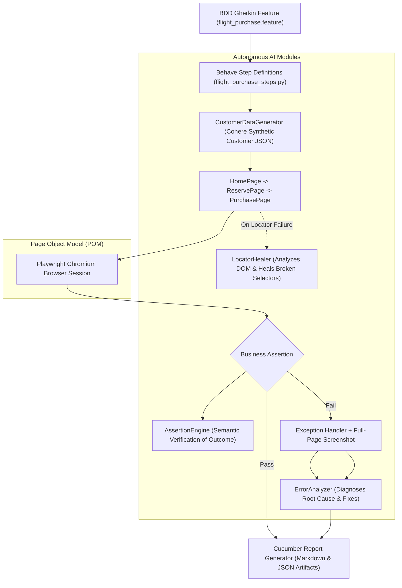

# Autonomous Playwright BDD AI Test Automation Framework

[](https://www.python.org/downloads/)
[](https://playwright.dev/python/)
[](https://behave.readthedocs.io/)
[](https://cohere.com/)
[](https://opensource.org/licenses/MIT)

An enterprise-grade, **Autonomous AI-Infused Test Automation Framework** integrating **Playwright**, **Behave (BDD/Cucumber Gherkin)**, the **Page Object Model (POM)**, and **Cohere GenAI agents**.

This framework moves beyond conventional test automation by introducing autonomous AI modules for **Synthetic Test Data Generation**, **Dynamic Self-Healing Locators**, **Semantic Natural Language Assertions**, and **Automated Root-Cause Failure Diagnostics**.

---

## Autonomous Architecture



---

## Autonomous AI Capabilities

| AI Module | Location | Purpose & Mechanism |
|---|---|---|
| **Synthetic Test Data Generator** | [`ai/test_data_generator.py`](ai/test_data_generator.py) | Instructs Cohere to synthesize compliant, non-deterministic customer records (names, addresses, credit cards) for checkout forms on the fly. |
| **Self-Healing Locator** | [`ai/locator_healer.py`](ai/locator_healer.py) | When a selector throws an exception due to DOM changes, `safe_fill()` captures page HTML and prompts Cohere to suggest a resilient replacement selector without failing the run. |
| **Semantic Assertion Engine** | [`ai/assertion_engine.py`](ai/assertion_engine.py) | Eliminates fragile hardcoded string assertions by asking Cohere to semantically verify purchase success from raw rendered page text. |
| **Root-Cause Error Analyzer** | [`ai/error_analyzer.py`](ai/error_analyzer.py) | On test exceptions, automatically inspects the call stack and DOM text to generate a structured 3-part diagnosis: Root Cause, Probable Reason, and Fix Recommendation. |
| **Excel Persistence + RAG** | [`ai/laptops_rag.py`](ai/laptops_rag.py) | Scrapes dynamic multi-page catalog rows, saves them to Excel workbooks, reloads them into RAG context, and queries Cohere for data validation. |

---

## Project Structure

```text
LLM-playwright-bdd-ai-framework/
├── .env.example                               # Environment template
├── .gitignore                                 # Git ignore patterns
├── LICENSE                                    # MIT License
├── README.md                                  # Repository documentation
├── DEMOBLAZE_LAPTOPS_SETUP.md                 # Setup guide for laptop RAG test
├── requirements.txt                           # Production dependencies
├── ai/                                        # Autonomous AI modules
│   ├── __init__.py
│   ├── cohere_helper.py                       # Unified Cohere ClientV2 connector
│   ├── test_data_generator.py                 # Synthetic customer data generator
│   ├── locator_healer.py                      # DOM inspection & self-healing selector
│   ├── error_analyzer.py                      # Root cause failure diagnostics
│   ├── assertion_engine.py                    # Semantic natural language assertion
│   └── laptops_rag.py                         # Excel catalog persistence + RAG QA
├── pages/                                     # Page Object Model (POM)
│   ├── __init__.py
│   ├── home_page.py                           # Flight search origin/destination
│   ├── reserve_page.py                        # Lowest flight fare selection
│   ├── purchase_page.py                       # Form filling with AI self-healing safe_fill()
│   └── laptops_page.py                        # Dynamic pagination catalog scraper
├── features/                                  # BDD Gherkin specifications
│   ├── environment.py                         # Behave hooks, screenshots & report exporter
│   ├── flight_purchase.feature                # Flight booking scenario
│   └── steps/
│       ├── __init__.py
│       └── flight_purchase_steps.py           # Step definitions linking POM + AI
├── tests/                                     # Pytest test suites
│   ├── __init__.py
│   ├── test_blazedemo_booking.py              # Pytest flight booking with AI data & assertions
│   └── test_demoblaze_laptops_rag.py          # Pytest laptop scraping + Excel RAG validation
└── artifacts/                                 # Run artifacts (reports, screenshots, excel)
```

---

## Getting Started

### 1. Prerequisites
- Python 3.10 or higher
- A Cohere API key ([Cohere Dashboard](https://dashboard.cohere.com/api-keys))

### 2. Installation

```bash
# Clone the repository
git clone https://github.com/<your-username>/LLM-playwright-bdd-ai-framework.git
cd LLM-playwright-bdd-ai-framework

# Create and activate virtual environment
python -m venv .venv

# Windows:
.venv\Scripts\activate
# Linux/macOS:
source .venv/bin/activate

# Install dependencies
pip install -r requirements.txt

# Install Playwright browser binaries
playwright install chromium
```

### 3. Environment Configuration

```bash
cp .env.example .env
```

Add your Cohere API key to `.env`:
```env
COHERE_API_KEY=your_actual_cohere_api_key_here
HEADLESS=false
```

---

## Running the Automated Suites

### 1. Execute BDD Gherkin Feature with Behave
```bash
behave features/flight_purchase.feature
```
> Generates comprehensive run summaries in `artifacts/cucumber_report.md` and `artifacts/cucumber_report.json`.

### 2. Execute Pytest Autonomous Booking Test
```bash
pytest tests/test_blazedemo_booking.py -s -v
```
> Demonstrates synthetic customer generation, safe form filling with self-healing selectors, and semantic confirmation assertions.

### 3. Execute Demoblaze Scraping + Excel RAG Test
```bash
pytest tests/test_demoblaze_laptops_rag.py -s -v
```
> Scrapes products across pagination, persists them to `artifacts/demoblaze_laptops.xlsx`, builds RAG context, and uses Cohere to find the cheapest laptop.

---

## Sample BDD Markdown Report

Upon running `behave`, `artifacts/cucumber_report.md` is automatically exported:

```markdown
# BlazeDemo BDD Cucumber Execution Report

- Scenario: Purchase the cheapest flight with AI synthetic test data and AI assertions
- Status: PASSED
- Route: Paris to New York
- Selected Price: $200.98
- Confirmation: Thank you for your purchase today!
- Order ID: 1729792015821

## Step Results

- PASSED: I open the BlazeDemo flight search
- PASSED: I search for flights from Paris to New York
- PASSED: I select the cheapest available flight
- PASSED: I complete the purchase with Cohere generated customer details
- PASSED: the purchase confirmation is displayed
- PASSED: the order ID is returned
```

---

## License
Distributed under the [MIT License](LICENSE).
